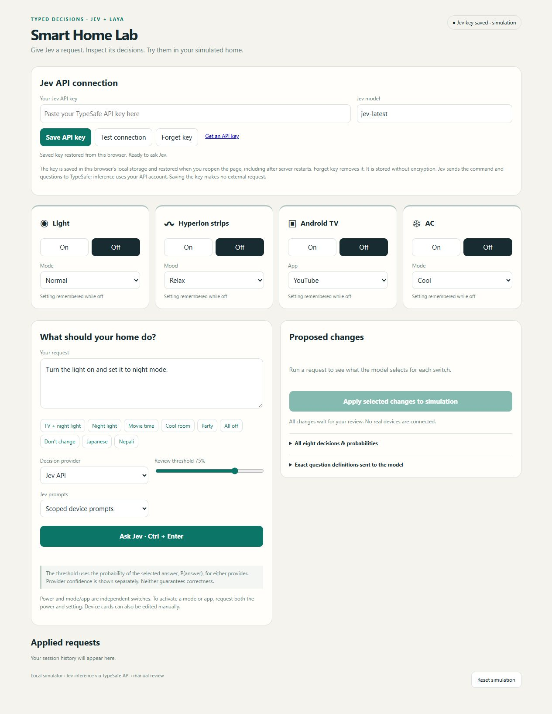
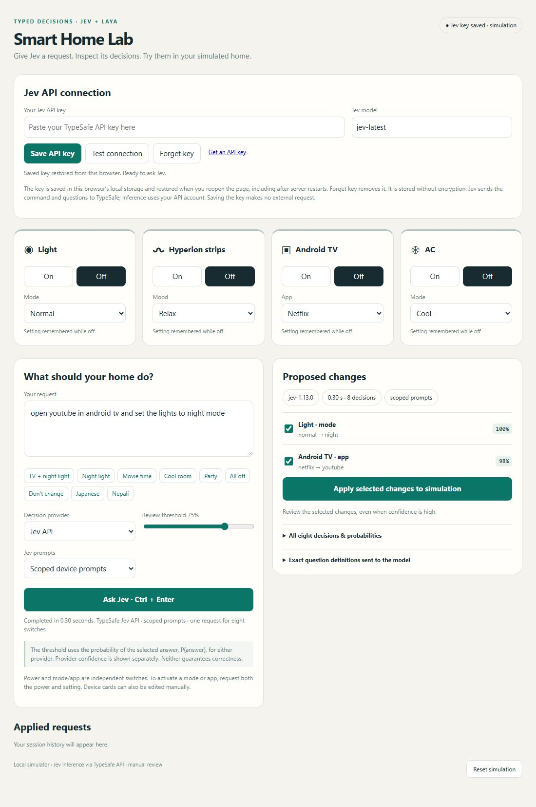

# Jev Smart Home Lab

A local smart-home playground using the [Jev API](https://docs.typesafe.ai/) and optional [Laya](https://github.com/NandhaKishorM/laya) CPU inference. Type a request, inspect eight device decisions and their probabilities, then apply selected changes to the simulation.

| Device | Controls |
| --- | --- |
| Light | On/Off · Night/Normal |
| Hyperion strips | On/Off · Relax/Focus/Party/Movie |
| Android TV | On/Off · YouTube/Netflix/Amazon Prime |
| AC | On/Off · Heat/Cool |

## Run locally

Requires **Python 3.12** and **Git**. From PowerShell:

```powershell
git clone https://github.com/SafalFrom2050/jev-smart-home-lab.git
cd jev-smart-home-lab
py -3.12 -m venv .venv
.\.venv\Scripts\python.exe -m pip install -r requirements-lock.txt --extra-index-url https://download.pytorch.org/whl/cpu
.\Start-Laya.ps1
```

Open **http://127.0.0.1:8000**, enter your Jev key, click **Save API key**, then **Ask Jev**. Stop with `.\Stop-Laya.ps1`. For offline Laya, run `.\.venv\Scripts\python.exe download_models.py` once and choose **Laya · local CPU**.

Keys persist unencrypted in your browser's local storage; **Forget key** removes them. Jev requests use your API account. No keys, model weights or virtual environment are included here.

## Screenshots





## Notes

**Scoped device prompts** is the default; the original prompts remain available for comparison. A six-case live trial improved from **3/6 to 6/6** completely correct requests, with about **2.46× input tokens**—a small experiment, not a general reliability claim.

Power and settings are independent. All changes require review, and no real devices are connected.

[Jev prompt results](JEV_PROMPT_FINDINGS.md) · [Laya evaluation](LAYA_FINDINGS.md) · [Detailed setup and tests](docs/SETUP.md)
